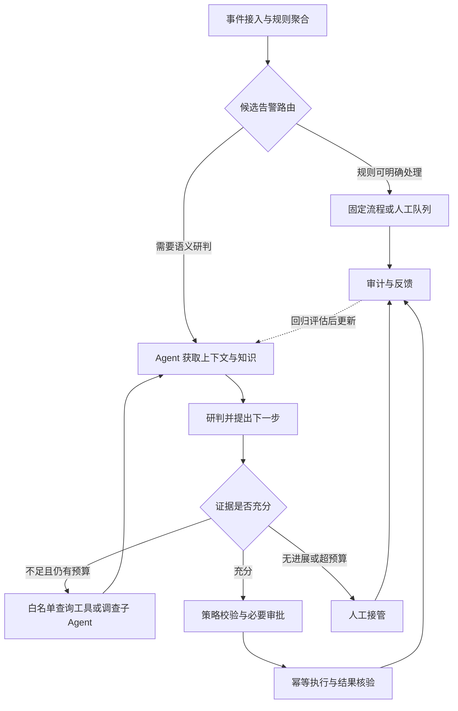

# AI Agent 工程化手册

**先沿着一条 SOC 告警看懂整个 Agent，再按模块深入。** 这条阅读主线回答：传统系统怎么做、为什么引入 Agent、每一层做什么、何时需要子 Agent，以及怎样证明它有效。

## 从你的 SOC 项目开始 {#soc-reading-path}

| 阅读顺序 | 进入专题 | 读完能回答什么 |
| --- | --- | --- |
| ① 范式演进 | [从传统 SOC 到受约束 Agent](./soc-agent-evolution.md) | 规则、SOAR、RAG、Agent 分别解决什么？模型在哪一步改变流程？ |
| ② 逐层拆解 | [Agent 七层职责与完整执行过程](./soc-agent-layers.md) | 每层的输入、决策、工具、输出、状态和异常路径是什么？ |
| ③ 协作设计 | [子 Agent 如何拆分与协作](./soc-agent-subagents.md) | 谁派任务、谁做调查、怎样交接、冲突和超时归谁处理？ |
| ④ 效果验证 | [SOC Agent 分层评估与上线闭环](./soc-agent-evaluation.md) | 评什么、用什么数据、怎么算、怎么定位问题和控制发布？ |

::: info 项目事实与设计方案
沿用你的业务背景：DLP、HIDS、天眼、AD、邮件网关；每日约 800–900 万条原始事件；ES 日新增 primary 约 150 GB，1 副本后约 300 GB。这是原始事件与存储口径，不能直接当作 Agent 调用量。

新增专题给出可落地的讲解方案。独立 Supervisor、子 Agent、预算数值和评估门槛均不自动等于现网事实；面试时只把有代码、Trace 或报表支撑的部分表述为“我已实现”。
:::

## 先看全局：确定性主流程包住 Agent {#overview}

**Agent 的关键变化发生在“证据不足 → 选择补查 → 读取结果 → 重新判断”这一段。** 如果所有查询和分支都由代码预先写死，应准确称为 LLM/RAG 增强的工作流。是否使用工具、RAG 或多个模型，都不能单独证明系统具备自主决策。

## 每层到底做了什么 {#layer-map}

这七层是职责视图，可以运行在同一个 Java 服务里；不是要求拆成七个 Agent 或七个微服务。

| 层 | SOC 中的具体工作 | 交给下一层的东西 |
| --- | --- | --- |
| L1 目标与编排 | 接受候选告警，定义调查目标、预算、状态与终止条件 | Task、运行状态、允许动作 |
| L2 感知与上下文 | 补资产、账号、进程、时间窗内相关事件；记录缺失信息 | 带来源和时间的事实包 |
| L3 知识与记忆 | 制度/SOP 与历史案例双域检索；隔离运行记忆和审核后的长期经验 | EvidenceBundle、知识版本 |
| L4 规划与研判 | 提出假设、识别证据缺口、选择补查或委派、形成结论 | Decision、NextStep、证据引用 |
| L5 工具与执行 | 校验参数和权限；执行查询或经过批准的处置；处理幂等和未知结果 | ToolResult、ActionResult |
| L6 校验与接管 | 检查证据支撑、策略冲突和真实执行结果；决定完成、补查或人工 | 可审计的结果与交接包 |
| L7 评估与反馈 | 回放、分层评分、灰度、人工复核；归因后更新知识/规则/模型 | 版本报告、回归用例 |

[逐层展开并跟踪一条 DLP 告警 →](./soc-agent-layers.md)

## 子 Agent 与评估的两个关键边界 {#boundaries}

**子 Agent 按调查责任拆分。** 例如端点调查、身份调查、外联调查分别拥有目标、上下文、只读工具和返回契约；Supervisor 汇总证据。BM25、向量检索、RRF、Rerank 通常属于检索流水线组件，无需各封装一个 Agent。[查看任务报文、协作图和冲突处理 →](./soc-agent-subagents.md)

**评估必须同时看组件、执行轨迹、最终业务结果。** 检索命中不等于研判正确，结论正确不等于处置成功；线上 Verifier 检查当前任务，离线评估体系验证系统整体质量。[查看评估集、指标分母和发布门槛 →](./soc-agent-evaluation.md)

## 基础与编排

项目主线之外，按问题进入原有专项题库：[LLM 与 Agent 基础](./01-llm-agent-basics.md)、[架构与编排](./02-architecture-orchestration.md)、[Prompt 与 Context](./03-prompt-context-engineering.md)、[Tools / MCP / A2A](./04-tools-mcp-a2a.md)、[Planning / Execution](./06-planning-execution-recovery.md)。

## RAG、记忆与多智能体

[RAG 与企业知识工程](./05-rag-knowledge-engineering.md) · [Memory 与 Session](./07-memory-session-personalization.md) · [Multi-Agent 题库](./08-multi-agent.md)。切片、ES 向量索引、双域检索与 RRF 的实现细节见 [SOC RAG 专项](/system-design/soc-agent.md#soc-rag-implementation)。

## 生产可靠性与治理

[生产工程、可靠性与成本](./09-production-reliability-cost.md) · [评估与可观测](./10-evaluation-observability.md) · [安全治理](./11-security-guardrails-governance.md) · [SOC 安全实战](./14-llm-agent-security-practice.md)。

安全实战覆盖提示注入、RAG 与缓存权限、审批参数绑定、执行隔离和 UNKNOWN 对账；验收场景是测试建议，不代表现网已全部通过。

## 系统设计与题库

[系统设计与项目深挖](./12-system-design-project-deep-dive.md) · [场景题库](./appendix-scenario-question-bank.md) · [正式面试复盘](./13-mock-interview-review-2026-09-04.md)。

## 使用与复习方式

第一次阅读按 ①→④ 走完项目主线；复习时先用七层表口述，再挑一个异常路径和一个评估指标接受追问。需要补基础时进入 [AI 学习与复习专区](/ai-study/)。项目历史问答与细节仍保留在 [SOC 系统设计全文](/system-design/soc-agent.md)。

正文保持 `reviewing`：架构建议经过资料核对，项目上线范围和效果仍需要真实运行证据。
