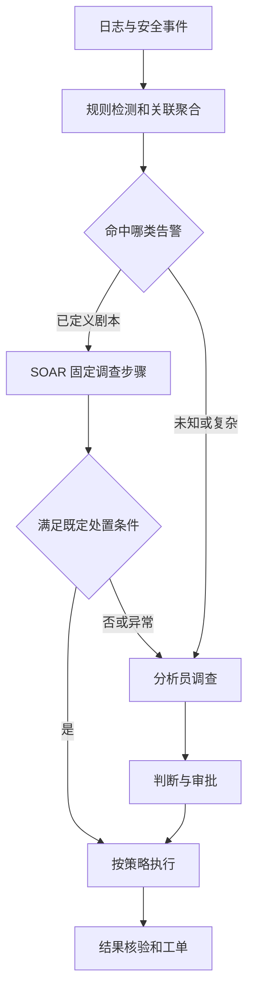
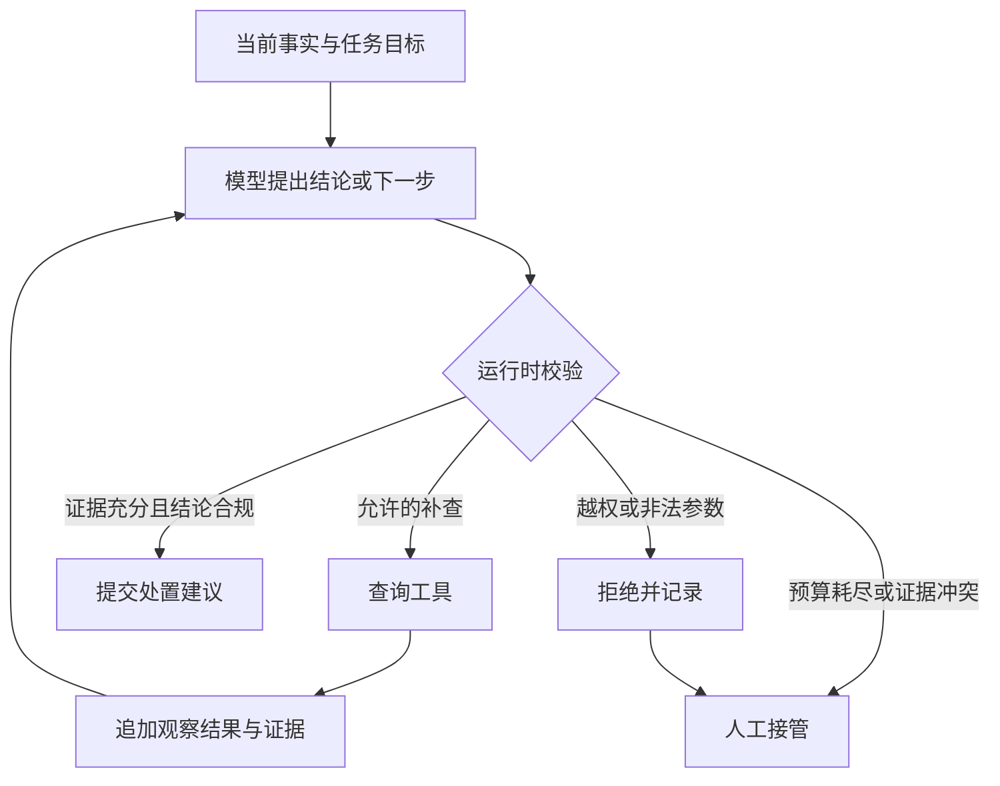

# 从传统 SOC 到受约束 Agent

**先说传统系统已经能做什么，再解释哪一段需要模型动态判断。** Agent 的价值要落在减少调查缺口、缩短研判时间和提高闭环质量上。

[返回项目主线](./index.md#soc-reading-path) · 下一篇：[七层职责与执行过程](./soc-agent-layers.md)

## 用一个问题贯穿所有范式

以下为教学案例：DLP 报告员工账号 `u-17` 在夜间通过主机 `h-42` 向外部域名传输敏感文件。需要判断这是批准的数据交付、误报还是账号失陷，并决定是否升级、调查或处置。

告警本身只能说明“检测到了某种行为”。判断至少还需要资产用途、外发审批、进程来源、账号登录情况、适用制度。**没有查到审批，不等于确定没有审批；工具不可用时，必须把结果标成 UNKNOWN。**

## 传统范式：规则检测、人工调查与 SOAR

| 环节 | 传统实现 | 遇到示例告警时的表现 |
| --- | --- | --- |
| 检测 | 规则、关联分析、异常检测 | 检出敏感文件外发，并聚合同源重复告警 |
| 调查 | 人工查资产、审批、账号、进程；或 SOAR 调接口 | 按剧本取回预定数据，未知情况升级人工 |
| 判断 | 人工结合经验和制度；简单情况由规则直接判定 | 同一告警在不同业务上下文下可能结论不同 |
| 执行 | 固定审批与处置流程 | 创建工单、通知、隔离等由权限和策略约束 |
| 改进 | 分析员维护规则、剧本和案例 | 新异常需要人工沉淀为可复用逻辑 |

SOAR 可以包含复杂分支、并行、重试和人工审批，并非只能顺序执行。它的关键是路径与条件主要由开发者预定义。规则检测和跨事件关联也继续保留；Agent 不能凭自然语言相似性替代这些能力。

## 加入 RAG 后：知识获取变快，路径仍可固定

固定工作流可以执行：补全告警 → 查制度和历史案例 → 将证据交给 LLM → 输出结构化结论 → 策略审批 → 执行。

它已经很有用：模型能解释外发制度、比较历史误报、生成带证据的研判建议。但如果审批查询没有预先编排，模型就只能使用已给的数据。即使 Prompt 要求“请认真思考”，也不会凭空拿到审批事实。

| 容易混淆的概念 | 实际负责什么 |
| --- | --- |
| 规则引擎 | 检测已定义条件、产生确定性约束 |
| RAG | 为当前问题找到适用的制度和案例 |
| LLM | 结合输入生成解释、结论或下一步建议 |
| Workflow | 编排预定义步骤、分支、状态和异常恢复 |
| Agent Loop | 根据观察结果选择下一步，再读取环境反馈，直到完成或停止 |

## 引入 Agent：证据缺口驱动下一步

在这个案例中，模型可以先提出“需要查外发审批”；发现审批存在但目标域名不一致后，再选择查进程树和账号登录。如果新证据仍冲突，就转人工，而不是硬给安全结论。

一次循环的工程接口可以是 `Decision(next_step, tool_args, evidence_refs, missing_evidence)`。由执行器验证并调用工具，再把结构化观察交回模型。模型不直接访问数据库、持有生产凭证或执行封禁。

| 范式 | SOC 用法 | 限制 |
| --- | --- | --- |
| Prompt chaining | 固定执行摘要、取证、研判和报告步骤 | 每次都走固定链；简单任务足够用 |
| Router | 按数据源、告警类型、资产风险进入专门流程 | 优先使用稳定字段路由，未知类进入兜底 |
| ReAct 类循环 | 研判 → 调用只读工具 → 根据结果补充判断 | 每轮要有新证据或明确进展；受步数和总预算限制 |
| Plan-and-Execute | 先列调查计划，再执行依赖步骤，必要时有限重规划 | 计划是受校验的建议；不能绕过强制检查 |
| Supervisor / Workers | 将独立的身份、端点、网络调查委派给专家 | 用证据契约汇总，避免重复调查和共享状态互相覆盖 |
| Evaluator-Optimizer | 检查结论证据，有限修订 | 在线复核不等于离线评估；不能无上限互相反思 |

这些模式可以组合。项目起点可采用“固定主流程 + 单 Agent 受限补查”，只在复杂跨域调查中验证多 Agent 是否有增益。

## 确定性流程与模型的责任边界

| 谁负责 | 可以决定 | 不能越过的边界 |
| --- | --- | --- |
| 后端编排器 | 身份、路由、必经节点、预算、暂停恢复、终态 | 不能把缺失证据伪装成查询成功 |
| LLM / Planner | 调查假设、补查目标、白名单内的下一步、研判建议 | 不能自行授权、扩大租户范围、跳过审批 |
| 检索服务 | 权限与有效期过滤、召回、融合、重排、组装引用 | 检索到的案例不是当前事件的事实证据 |
| Policy / Executor | 权限判定、动作参数校验、审批绑定、幂等执行 | 模型输出高置信度不能直接变成动作授权 |
| 人工分析员 | 争议裁决、高风险审批、最终标签确认 | 审批要绑定具体对象和参数，不能无限复用 |

## 怎样证明“我确实做了 Agent”

拿出同类告警的两条脱敏 Trace：一条因审批匹配直接完成研判，另一条因目标不匹配触发进程或身份补查。解释是谁决定这个分支、工具返回如何改变下一步、何时停止，以及状态如何恢复。

如果这些分支全部来自代码，应描述为“LLM 增强的受控工作流”。如果模型在运行中选择补查和工具，可以进一步描述其 Agent 自主性。每个角色只调用一次模型且没有独立调查循环时，可以称为专家节点或 Worker；不必为了面试包装成完整子 Agent。

## 90 秒讲述模板

我们的 SOC 原有链路负责接入、规则检测、告警聚合和工单处置，难点在于复杂告警需要人反复查资产、账号、制度和历史案例。设计上先用 RAG 补齐制度与案例，再在证据不足的环节加入受约束调查循环：模型提出要查什么，后端验证工具和参数，读取真实结果后重新判断。身份、预算、审批、幂等和恢复由确定性编排控制。复杂跨域调查可以按需委派给专业子 Agent，但要与单 Agent 基线比较。效果用真实攻击识别、错误自动处置、人工接管、任务成功率、延迟和成本共同评估。

使用时把“设计上”改成实际实现范围，并给出你亲自负责的模块及证据；未落地的子 Agent 继续作为演进方案说明。

## 依据与继续阅读

- [Anthropic：Building effective agents](https://www.anthropic.com/engineering/building-effective-agents)：Workflow 与 Agent 的边界，以及常见组合模式。
- [Spring AI：Building Effective Agents](https://docs.spring.io/spring-ai/reference/api/effective-agents.html)：这些模式在 Java 生态中的示例。
- [架构与编排专项题库](./02-architecture-orchestration.md)：恢复、幂等、多租户和状态机追问。

下一篇：[把 Agent 七层落实到输入、状态、工具与一次完整运行](./soc-agent-layers.md)。
