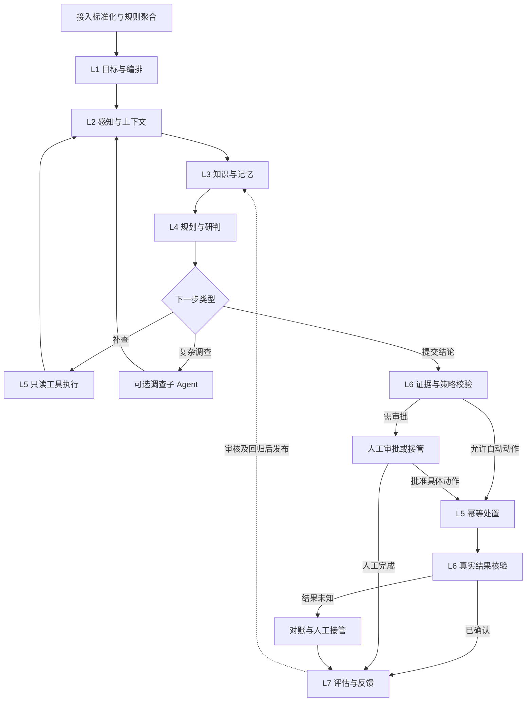

# SOC Agent 七层职责与完整执行过程

**面试要讲清的不是七个名词，而是每一层怎样把不确定的模型建议变成可核验的业务结果。** 以下类名和报文是建议实现，不表示仓库已有生产服务源码。

[上一篇：传统范式与 Agent](./soc-agent-evolution.md) · [返回主线](./index.md) · [下一篇：子 Agent](./soc-agent-subagents.md)

## 职责架构：主流程、调查循环与反馈 {#architecture}



L5 同时提供“只读查询”和“有副作用的处置”两类执行能力，权限和恢复策略不同；L6 分别检查执行前结论与执行后结果。评估作为旁路读取全链路 Trace，不必同步阻塞每个任务。

## L1：目标与编排——定义这次任务要完成什么 {#l1}

**输入：** 已聚合的候选告警、租户身份、风险级别。**工程职责：** `TaskOrchestrator` 创建任务，写入目标、范围、预算与验收条件；通过持久化状态机控制运行。

目标必须能判断完成，例如“判断外发是否经过批准，识别账号/主机是否需要继续调查，输出带证据的结论和允许的处置建议”。不能只写“请分析这个告警”。成功结束、转人工、超预算分别是不同终态。

```json
{
  "task_id": "soc-task-1042",
  "tenant_id": "tenant-a",
  "alert_id": "dlp-1042",
  "goal": "判断外发是否合规及是否需要升级调查",
  "scope": {"host_id": "h-42", "user_id": "u-17"},
  "required_checks": ["approval_match", "policy_applicability"],
  "budget": {"max_steps": 6, "max_tool_calls": 8, "deadline_ms": 45000},
  "completion": ["claims_have_evidence", "missing_evidence_explicit", "action_policy_checked"]
}
```

**预算只是压测起点示例**，应由模型延迟、工具耗时、任务风险和业务 SLO 校准。`tenant_id` 和实际权限从服务端认证上下文绑定，不能信任模型回传的租户字段。

**状态与异常：** 保存 `task_id / run_id / state_version / step / deadline / versions`。用版本检查防止多个 Worker 同时推进；审批等待通过持久化恢复，不能占着线程长期等待。原始事件吞吐、候选告警吞吐、Agent 任务吞吐、模型调用吞吐分别统计。

## L2：感知与上下文——把告警变成可用事实 {#l2}

**输入：** 当前告警和已获授权的补查请求。**工程职责：** `ContextAssembler` 统一数据源字段、获取必要上下文、区分观察事实和推断。

| 信息 | 来源与查询边界 | 应保留的输出 |
| --- | --- | --- |
| 外发行为 | DLP 事件 ID、文件标签、目标、时间 | 原始证据引用、观察时间、数据完整性 |
| 主机与进程 | 资产服务、HIDS；按 host_id 和时间窗 | 资产用途、进程链、缺失字段 |
| 账号行为 | AD/身份系统；按 user_id 和租户 | 登录地点、认证结果、账号权限及覆盖窗口 |
| 外发审批 | 审批服务；按人员、文件、接收方和时间匹配 | MATCH / MISMATCH / NOT_FOUND / UNAVAILABLE |
| 外联或邮件 | 天眼、邮件网关；按对象和时间限定 | 域名/IP、投递链路、相关事件引用 |

结构化相关查询先用稳定实体键和时间窗；模型负责解释拿到的关系，不自行把两条“语义类似”的事件当成同一攻击。工具失败保留 `UNAVAILABLE`，查询完整且无记录才可以使用 `NOT_FOUND`，二者都需要按业务规则解释。

**状态与异常：** 原始证据持久化为不可变引用，运行上下文保留摘要和出处。大 payload 按字段投影、分页或事件组提取，不把数千条日志直接塞进 Prompt。日志正文属于不可信数据，其中的指令不能改变系统权限或任务目标。

## L3：知识与记忆——分清规则依据、类比经验和当前事实 {#l3}

**输入：** 告警事实、调查问题、租户权限和适用时间。**工程职责：** `KnowledgeService` 返回可引用的知识；`RunStateStore` 保存当前调查状态。

| 数据 | 怎么组织和使用 | 不能混淆的边界 |
| --- | --- | --- |
| 制度 / SOP / 产品说明 | 按文档结构切片，保留标题路径、条款号、版本、适用范围、有效期；子块召回后按预算补父段落 | 制度依据必须适用于当前业务和时间 |
| 历史工单 / 误报 / 攻击案例 | 按事件概要、证据、结论、处置分区；关联 case_id 和审核状态 | 类似案例支持假设，不证明本次事件也是误报 |
| 当前告警 | 规范化字段加简短调查描述，生成查询；超长内容按实体/事件组提取 | 不机械按固定字数切掉对象、时间和进程关系 |
| 短期运行记忆 | 当前目标、证据引用、已查工具、待补项、剩余预算 | 摘要不是事实库；恢复要能追到原始结果 |
| 长期经验 | 经人工审核的案例、有效制度、已验证规则 | 模型自我总结不直接进入可信知识库 |

制度和案例分别经过权限、适用范围与时间过滤，再做 BM25/向量召回、RRF 融合、可选重排和引用装配。为双域设置上下文配额，避免大量相似案例挤掉必须遵守的制度。RRF 的排序分数不能当作“事件是真实攻击的概率”。

**输出：** `EvidenceBundle` 至少含 `evidence_id / source_type / source_ref / text / version / observed_at / valid_from / valid_to`，并明确哪些是当前事实、哪些是规范、哪些是历史类比。

**状态与异常：** 缓存键包括租户、权限范围、查询和知识版本；关键制度不可用则标记缺口并升级，不用历史案例代替当前制度。切片、ES 索引与 RRF 的完整实现继续见 [SOC RAG 专项](/system-design/soc-agent.md#soc-rag-implementation)。

## L4：规划与研判——模型真正做决策的地方 {#l4}

**输入：** 目标、当前事实、知识依据、允许工具、已做步骤和剩余预算。**工程职责：** `DecisionService` 调用模型得到受约束的下一步，`PlanValidator` 检查后才交给执行器。

| 结果类型 | 触发条件 | 后续分支 |
| --- | --- | --- |
| QUERY | 某个明确问题可通过允许的工具补齐 | L5 查询，再更新 L2/L3 |
| DELEGATE | 可独立验收的跨域调查，且允许启用子 Agent | 派发子任务，收回证据摘要 |
| CONCLUDE | 关键检查完成、证据足以支持结论 | L6 校验，再进入动作授权 |
| ESCALATE | 证据冲突、工具长期不可用、无进展或预算不足 | 输出人工交接包 |

```json
{
  "task_id": "soc-task-1042",
  "step": 2,
  "decision": "QUERY",
  "reason_summary": "外发审批接收方与实际目标不一致，需要核查进程来源",
  "evidence_refs": ["dlp:event-1042", "approval:result-7"],
  "missing_evidence": ["process_origin"],
  "tool": "get_process_tree",
  "arguments": {"host_id": "h-42", "event_ref": "dlp:event-1042"}
}
```

这是用于审计的简短决策依据，不要求存储模型隐藏思维链。`reason_summary` 必须引用实际返回证据，不能用语言流畅程度代替真实性。

**终止与异常：** 限制模型轮数、工具次数、总 Token、总时限；把相同工具和等价参数生成指纹，防止循环补查。业务上允许刷新时，明确新的时间窗或证据版本。格式错误可有限重试，持续错误转人工。模型自报 `confidence=0.99` 不是已校准概率，更不是自动封禁许可。

## L5：工具与执行——把建议变成受控操作 {#l5}

**输入：** 已校验的查询请求或已授权的动作意图。**工程职责：** `ToolGateway` 负责 schema、授权、范围、限流、超时；`ActionExecutor` 负责副作用及幂等。

| 工具类别 | 示例 | 执行与恢复规则 |
| --- | --- | --- |
| 只读查询 | 查审批、进程、登录、制度 | 限定对象/时间/行数；按错误类型有限退避；返回事实状态 |
| 低风险写操作 | 创建工单、通知 | 使用稳定业务幂等键，记录下游引用；同一意图重试复用键 |
| 高影响处置 | 主机隔离、账号禁用 | 确定性策略 + 必要审批；审批绑定目标、参数摘要、有效期和策略版本 |

动作意图先持久化：`action_id / task_id / action_type / target / params_hash / approval_ref / status / downstream_ref`。`action_id` 标识一次逻辑动作，技术重试不能换新 ID。参数发生实质变化时重新授权，不能借重试使用旧审批。

**未知结果处理：** 调用超时不等于失败。写操作进入 `UNKNOWN` 后先按下游操作 ID 查询或对账；缺少下游幂等和查单能力时保留人工确认，不能盲目重复执行。隔离成功但工单失败，分别恢复；不能为了让状态“对齐”自动解封。

需要同步保存业务状态与后续写 ES/发通知意图时，可采用本地事务 + Outbox，异步投影到 ES；不要把跨线程、跨存储调用误认为被一个 Spring 本地事务覆盖。完整机制见 [规划、执行与恢复](./06-planning-execution-recovery.md)。

## L6：校验与人工接管——确认结论和结果都成立 {#l6}

**输入：** 模型结论、证据引用、策略检查结果或下游执行回执。**工程职责：** `ResultVerifier` 做确定性校验，必要时增加独立语义审查；`HandoffService` 交接人工。

| 校验时点 | 必须检查 | 失败怎么办 |
| --- | --- | --- |
| 结论提交时 | 引用存在、租户一致、制度适用、重要主张有证据、缺失信息被声明 | 可补齐则有限补查，否则人工 |
| 动作执行前 | 对象和参数在授权范围、审批未过期、策略未变化 | 拒绝执行或重新审批 |
| 动作执行后 | 下游是否真正达到预期状态，而非仅 HTTP 200/已受理 | 继续查证、UNKNOWN 对账或人工 |
| 人工接管时 | 已知事实、冲突、未查事项、已发生动作、版本和可恢复位置 | 持久化交接，避免人工从头调查 |

Verifier 可以发现“审批存在”不足以支持“本次外发合规”，因为接收方、文件范围和时间仍可能不匹配。另一个 LLM 的同意也不能替代确定性证据检查，尤其两个模型可能共享同一偏差。

## L7：评估与反馈——定位是哪一层变差 {#l7}

**输入：** 全链路 Trace、专家标签、执行状态、耗时与成本。**工程职责：** `EvaluationRunner` 回放固定样本；`FeedbackPipeline` 去重、审核、分类并发布新版本。

每条 Trace 串起 `task_id / run_id / parent_run_id / agent_role / tool_call_id / action_id`，以及模型、Prompt、知识、检索、工具、策略和代码版本。反馈先定位到“缺数据、漏召回、排序错误、推断错误、授权错误、执行失败或错误评分”，再选择修复点。

**状态与异常：** 自动归档不等于删除审计事实；延迟出现的攻击标签要能回写原预测版本。未审核的用户反馈不能直接进入生产知识。具体计算方法和发布流程见 [SOC 分层评估](./soc-agent-evaluation.md)。

## 一条 DLP 告警究竟怎么跑 {#worked-example}

以下是示例轨迹，不是现网观测数据。

| 步骤 | 所在层与输入 | 发生了什么 | 输出或分支 |
| --- | --- | --- | --- |
| 1 | L1：候选告警 dlp-1042 | 建调查任务、确定范围和预算 | 状态 RUNNING |
| 2 | L2：账号、主机、目标域名 | 补齐资产与基础事件，审批信息尚缺 | 明确 missing_evidence |
| 3 | L3：外发调查问题 | 找到现行外发制度与已审核历史案例 | 制度 p-3、案例 c-8；各保留引用 |
| 4 | L4 → L5：缺审批 | 选择 get_approval 并校验执行 | 审批存在，但接收方不匹配 |
| 5 | L4 → L5：冲突未解释 | 选择 get_process_tree；复杂时可委派端点调查 | 取回非预期进程发起外发的证据 |
| 6 | L4 → L6：汇总证据 | 不能仅凭“有审批”判误报；建议升级事件 | 风险结论、依据、仍缺信息 |
| 7 | L6 → 人工：处置建议 | 对隔离动作进行对象和参数绑定审批 | WAITING_APPROVAL 或拒绝处置 |
| 8 | L5 → L6：审批通过 | 执行并查证真实结果；超时进入 UNKNOWN | CONFIRMED 或转对账 |
| 9 | L7：完整 Trace | 专家复核，记录标签、耗时、成本与错误归因 | 评估样本或回归用例 |

正常另一条分支可以在第 4 步发现审批完全匹配，并在所有必需检查通过后结束；工具故障分支则保留缺失信息转人工。**分支差异、状态记录和停止条件，正是面试官要看到的 Agent 实现。**

## 怎样映射到个人贡献

| 你要讲的贡献 | 可以出示的工程证据 |
| --- | --- |
| 我做了任务编排与恢复 | 状态转换、版本检查、审批恢复与故障演练 |
| 我做了上下文和检索 | 数据源适配、过滤条件、证据契约、检索评估 |
| 我做了模型决策边界 | Decision schema、白名单、预算和两条不同分支 Trace |
| 我做了可靠处置 | 稳定 action_id、审批绑定、UNKNOWN 对账与 Outbox |
| 我做了质量闭环 | 版本化评估集、指标分母、错误归因和发布报告 |

只选择自己真正承担的部分。七层完整性说明你理解系统，个人贡献则由真实代码和结果来支撑。
