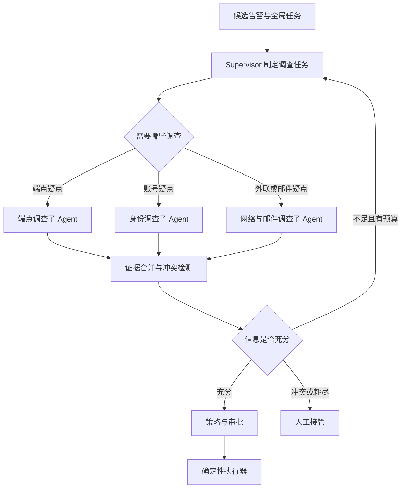

# SOC 子 Agent 如何拆分与协作

**先用单 Agent + 工具完成基线，只有独立调查带来的收益超过协作成本时，才引入子 Agent。** 这里描述可选演进方案，不把“如果有子 Agent”写成已上线事实。

[上一篇：七层与执行过程](./soc-agent-layers.md) · [返回主线](./index.md) · [下一篇：分层评估](./soc-agent-evaluation.md)

## 什么需要拆，什么留作普通组件

| 能力 | 建议形态 | 原因 |
| --- | --- | --- |
| BM25、向量查询、RRF、重排 | 检索服务内部组件 | 算法步骤明确，增加角色对话没有必然收益 |
| 查主机资产、查一条审批 | Tool | 输入输出稳定，通常一个确定性查询就能完成 |
| 结合进程、文件、外联逐步调查端点 | 可选端点子 Agent | 有独立问题、专用证据、工具和停止条件 |
| 结合登录、权限和账号行为调查身份 | 可选身份子 Agent | 专业上下文不同，可独立验收 |
| 状态持久化、预算、权限、动作幂等 | 确定性运行时 | 必须保持可预测，不能交给角色协商 |
| 对结论做独立检查 | 规则校验 + 可选审查模型 | 复核者也是可能出错的组件，需要单独评估 |

**一个子 Agent 是一份独立运行契约：目标、上下文、工具权限、运行状态、预算、输出与验收。** 它可以复用同一个模型和同一个服务进程，并不要求一个角色一个微服务。如果角色只是固定的一次模型调用，可以作为 Worker 节点实现。

## 推荐拓扑：Supervisor 按需委派 {#topology}



只启动当前问题需要的专家。DLP 外发告警若审批已经匹配、必要检查也全部通过，不需要强行启动全部子 Agent。固定并行三个节点属于并行工作流；由 Supervisor 基于证据选择子任务，才体现动态委派。

默认采用“子 Agent 作为可调用能力”：父任务保留总责任和最终汇总权。真正的 Handoff 是把后续控制责任转给接收者；没有独立所有权需求时，不必引入这种交接复杂度。

## 每个角色做什么 {#roles}

| 角色 | 接受的调查目标 | 允许的工具与上下文 | 返回什么 |
| --- | --- | --- | --- |
| Supervisor | 判断外发风险并找出证据缺口 | 告警概要、制度、子任务摘要；委派接口 | 子任务计划、综合结论、待补证据、动作建议 |
| 端点调查 | 外发是否由预期进程发起？ | HIDS 进程树、文件信息、主机资产；相关时间窗 | 进程链事实、异常点、证据 ID、覆盖范围 |
| 身份调查 | 账号是否存在异常登录或权限变化？ | AD/身份登录、权限记录；限定账号 | 账号行为事实、风险假设、缺失数据 |
| 网络与邮件调查 | 目标与传输链路是否符合业务预期？ | 天眼外联、邮件投递、授权情报查询 | 目标关联、流向证据、时间关系 |
| Verifier | 结论是否有依据、关键检查是否完成？ | 结果与所引用的原始证据、策略 | 接受、要求补查或拒绝；不能直接授予权限 |
| ActionExecutor | 执行已授权的具体动作 | 绑定参数的审批和操作凭证 | action_id、下游操作 ID、确认状态 |

后三个名字描述职责，不意味着都必须再运行一个 LLM。特别是策略校验、授权和执行幂等用确定性代码实现。

## 派给子 Agent 的任务报文 {#contract}

以下为示例：Supervisor 把“审批目标不匹配，需核查外发进程”的缺口委派给端点专家。

```json
{
  "contract_version": "1",
  "task_id": "soc-task-1042",
  "parent_run_id": "run-main-1",
  "subtask_id": "endpoint-1",
  "attempt_id": "endpoint-1-a1",
  "state_version": 4,
  "role": "endpoint_investigator",
  "objective": "确认 h-42 外发进程是否符合已批准的业务活动",
  "scope": {"host_id": "h-42", "event_ref": "dlp:event-1042"},
  "context_refs": ["dlp:event-1042", "approval:result-7", "policy:p-3"],
  "allowed_tools": ["get_process_tree", "get_file_metadata", "get_asset"],
  "budget": {"max_steps": 3, "max_tool_calls": 4, "deadline_ms": 15000},
  "acceptance": ["facts_have_evidence", "coverage_explicit", "no_write_actions"]
}
```

预算仅为设计示例。实际权限由运行时求交集：调用者权限 ∩ 父任务权限 ∩ 角色允许范围；`allowed_tools` 是约束声明，不能让模型据此自行授权。子任务共享全局预算，不能靠多开子任务突破总限制。

父任务传引用和必要摘要，子任务在授权下读取原始证据。不要复制整段父对话；保留与任务有关的事实、制度、缺口和工具限制，以减少污染和 Token 开销。

## 子 Agent 内部也有自己的小循环

端点子 Agent 的过程可以是：读取目标和证据 → 发现进程来源未知 → 查询进程树 → 发现父进程异常 → 查询文件元信息 → 输出有依据的发现或 `INSUFFICIENT_EVIDENCE`。

它沿用 [七层职责](./soc-agent-layers.md)：L1 接收子目标；L2/L3 建立局部上下文；L4 决定调查步骤；L5 只读查询；L6 检查本地输出；L7 记录子运行 Trace。全局策略、最终处置和任务终态仍由父任务的确定性运行时控制。

```json
{
  "subtask_id": "endpoint-1",
  "attempt_id": "endpoint-1-a1",
  "status": "COMPLETED",
  "findings": [
    {
      "claim": "发起外发的进程与批准的业务程序不一致",
      "evidence_refs": ["hids:process-932", "approval:result-7"],
      "kind": "observation_comparison"
    }
  ],
  "coverage": {"host_id": "h-42", "process_tree_available": true},
  "unknowns": ["文件完整内容未授权读取"],
  "recommended_next_step": "升级人工复核并评估隔离",
  "usage": {"model_calls": 2, "tool_calls": 2},
  "side_effects": []
}
```

`COMPLETED` 表示子任务按契约完成，不等于确认攻击、整个任务成功或动作获批。不同状态要区分 `COMPLETED / INSUFFICIENT_EVIDENCE / TIMED_OUT / FAILED / CANCELLED`。

## 证据怎么合并，结论冲突怎么办 {#merge}

Supervisor 汇总事实和覆盖范围，不投票决定真相。多名专家引用同一条日志，也只是一份证据，不能计成多份独立佐证。

| 场景 | 合并规则 |
| --- | --- |
| 端点称“可疑”，身份称“正常” | 先核对判断对象；账号正常不否定进程异常，两条可以同时成立 |
| 同一事实相互矛盾 | 比对数据源、对象、时间和版本；补查权威记录；仍冲突则人工 |
| 一方“没有异常”但数据不完整 | 降为覆盖不足；不能当作排除风险的证据 |
| 多个结论依赖同一案例 | 保留原始引用、去重并标明共同来源，避免重复增强置信度 |
| 历史案例与现行制度冲突 | 检查制度适用范围及有效期；历史处置不能覆盖当前政策 |

全局状态由父任务归并：子任务只提交自己的结果，不覆盖父任务的结论字段。结果写入绑定 `subtask_id + attempt_id`；过期尝试和取消后迟到结果不能重新推进当前状态。重试可复用已确认查询结果，但要检查证据新鲜度。

## 超时、递归与成本怎么控制 {#failure}

- **并行与依赖：** 端点和身份调查可以独立并发；依赖端点发现的目标再查外联时，等待前置结果。并行不能忽略下游配额。
- **全局预算：** 派发前预留子任务配额，结束后结算；剩余预算还要留给汇总与校验。父任务到期就停止新派发并取消可取消的子任务。
- **禁止任意递归：** 默认专家不能互相委派；只有 Supervisor 创建子任务。确有需要才允许有限层级，并记录调用图以阻断循环。
- **部分失败：** 缺少关键身份或审批证据时，不能用其他专家的成功掩盖；标注缺口并升级。非关键工具失败可在政策允许下给出受限结论。
- **故障隔离：** 按租户、角色和工具分别限制并发；模型不可用时规则检测、告警留存和人工队列继续运行。
- **副作用隔离：** 调查子 Agent 默认只读，最终写操作统一经过策略与执行器；避免多个子 Agent 同时隔离同一主机。

## 怎样证明多 Agent 值得上线

在相同时间范围的独立测试集上比较：固定 RAG 工作流、单 Agent + 工具、按需多 Agent。记录端到端任务成功率、证据完整性、错误处置、P95 延迟和每个成功任务的成本；同时给出相同预算下的比较，避免把更多 Token 的收益全部归因于拓扑。

再做消融：关闭身份专家、关闭端点专家、改成固定并行，分别观察哪些样本退化。如果复杂跨域样本有稳定提升，而普通告警无收益，就只为复杂任务启用；无需全量切到多 Agent。实验流程见 [评估专题](./soc-agent-evaluation.md#baselines)。

## 面试时的讲法与来源

如果尚未落地：可以说“当前是单 Agent 的受约束工作流；下一步计划将独立的端点与身份调查拆为专家子任务，采用 Supervisor 统一派发和汇总，并用质量、成本和延迟的对照实验决定启用范围”。

如果已经落地：补上真实角色数、启用比例、预算、冲突处理实例，以及单 Agent 对照结果。不能只展示一张很多 Agent 的图。

参考 [Anthropic：How we built our multi-agent research system](https://www.anthropic.com/engineering/multi-agent-research-system)。其中的研究任务经验支持分工、上下文隔离和结果汇总思路；本文的 SOC 角色划分与权限边界是面向本场景的设计建议，不是该报告的部署方案。
